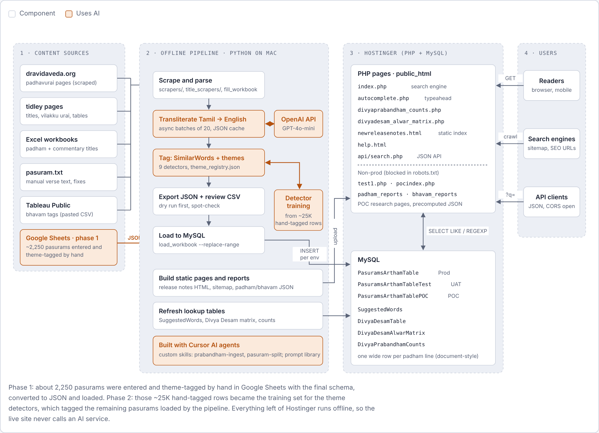

# Nalayiram.in

**AI-assisted Tamil scripture research platform** · Live at [nalayiram.in](https://nalayiram.in)

A free search engine that gives word-by-word meanings (*padhavurai*) for all **4,058 pasurams** of the Nalayira Divya Prabandham. Readers can search in Tamil or English by word, verse number (e.g. `2-8-2`), prabandham, Azhwar or Divya Desam.



## How it was built

**Phase 1: a hand-labeled foundation.** About 2,250 pasurams (~25K word-level rows) were entered by hand in Google Sheets with the final schema, theme-tagged manually, converted to JSON and loaded into MySQL.

**Phase 2: automation trained on that data.** The hand-tagged rows became the training set for nine theme detectors (Ramayana, Mahabharatham, Narasimha, Vamanan, Gajendran, Garudan, Sangu, Chakkaram, Sivan). A Python pipeline then ingested the remaining pasurams:

```
scrape / Excel / text  →  GPT-4o-mini transliteration  →  SimilarWords + theme tagging  →  JSON + review CSV  →  MySQL
```

- **Transliteration:** Tamil padham → English with OpenAI GPT-4o-mini, sent in async batches of 20 with retries, output sanitising and a JSON cache so each word is sent once.
- **Theme detectors:** keyword signals mined from the labeled rows ([`lookupsimilarwords/`](lookupsimilarwords/)), validated against reviewed CSV reports before being applied.
- **Safe loads:** every load runs as a dry run first, then goes POC → UAT → production.
- **Agentic development:** built with Cursor AI agents, custom agent skills ([`.cursor/skills/`](.cursor/skills/)) and a reusable prompt library ([`nalayiram-prompts.md`](nalayiram-prompts.md)).

All AI work happens offline. The live site runs plain SQL search over the enriched rows, so it stays fast, cheap to host and consistent.

## Site features

| Page | Purpose |
|---|---|
| `index.php` | Search by word, verse, prabandham, Azhwar or Divya Desam, with autocomplete |
| `divyaprabandham_counts.php` | Verse counts per prabandham |
| `divyadesam_alwar_matrix.php` | Divya Desam × Azhwar verse-count matrix |
| `newreleasenotes.html` | Clickable index of every verse and pathigam |
| `api/search.php` | Public JSON search API |

## Tech stack

Python (pandas, BeautifulSoup, mysql-connector, OpenAI SDK) · PHP · MySQL · jQuery UI · Hostinger

## Repository layout

| Path | Contents |
|---|---|
| `public_html/` | Website: PHP pages, static HTML, JSON API |
| `poc/` | Ingestion pipeline: scrapers, transliteration, loaders, build scripts |
| `lookupsimilarwords/` | Theme registry, detector training, validation reports |
| `docs/` | Full ingestion pipeline guide |

## Environments

| Env | MySQL table | Page | Config |
|---|---|---|---|
| POC | `PasuramsArthamTablePOC` | `pocindex.php` | `poc/config.ini` |
| UAT | `PasuramsArthamTableTest` | `test1.php` | `poc/config.test.ini` |
| Prod | `PasuramsArthamTable` | `index.php` | `poc/config.prod.ini` |

## Running the pipeline

```bash
python -m venv poc/.venv && poc/.venv/bin/pip install -r poc/requirements.txt
cp poc/config.example.ini poc/config.ini      # add your own DB details; this file is git-ignored
export OPENAI_API_KEY=...                       # only needed for transliteration
poc/.venv/bin/python -m poc.orchestrate_poc --config poc/config.ini --output poc/output/pasurams_poc.json
```

Credentials are never committed: `poc/config*.ini`, `public_html/database.php` and similar files are listed in `.gitignore`.

## Author

Anand Sampathkumaran · [nalayiram.in](https://nalayiram.in) · feedback@nalayiram.in

Commentary source: *Divya Artha Deepika* by Sri Kanchi Prativadi Bhayankaram Annangarachariar.
