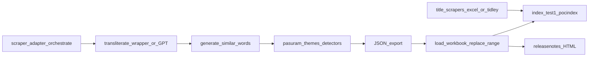

# Pasuram ingestion pipeline (end-to-end)

Single reference for adding new pasuram ranges: **scrape → transliteration → JSON → SimilarWords + themes → MySQL → commentary titles → release notes → website upload**.

Related docs (subsets of this guide):

- [docs/SESSION_RESUME.md](SESSION_RESUME.md) — current POC progress and resume checklist
- [poc/README.md](../poc/README.md) — POC quick start
- [lookupsimilarwords/README.md](../lookupsimilarwords/README.md) — theme detectors and vetting
- [poc/UAT_THIRUVANDHATHI.md](../poc/UAT_THIRUVANDHATHI.md) — UAT loads, title/theme apply, and `test1.php` checklist

---

## New prabandham checklist

Copy this block when starting a session (fill in `<…>` placeholders):

```text
Prabandham: <name>
Pasuram range: <START>–<END>
Path: <A scrape | B Excel padham | C Excel Title | D tidley vilakku | E tidley Title | F tidley table padham>
POC: yes / TEST: yes / Production: manual
Title format (if vilakku): (<section>) - <commentary>
Thaniyans: yes/no — Excel PattuNumber=0 → DB PasuramNumber=0
```

### 1. Choose path

| If you have… | Path | Section |
|--------------|------|---------|
| Nothing in DB yet; padham from dravidaveda.org | **A** Scrape | [§2](#2-path-a--scrape-a-new-range-from-dravidavedaorg) |
| Padham/meaning in `.xlsx` (Thiruvandhathi style) | **B** Excel fill + load | [§3](#3-path-b--excel-workbook-thiruvandhathi-pattern) |
| Padham rows exist; commentary in `*-commentary.xlsx` | **C** Title from Excel | [§4](#4-path-c--excel-commentary-titles-title-column-only) |
| Periyazhvar vilakku on tidley | **D** Vilakku urai | [§5](#5-path-d--periyazhvar-vilakku-urai-from-tidley) |
| Thiruvandhathi title on tidley | **E** Tidley Title | [§6](#6-path-e--thiruvandhathi-titles-from-tidley) |
| Long prabandham with padham tables on tidley (e.g. திருவெழுகூற்றிருக்கை) | **F** Tidley table padham | [§7](#7-path-f--tidley-table-padham-thiruvozhukootrirukkai) |
| பெரிய திருமொழி patthu (Dravidaveda padhavurai + `pasuram.txt` titles/verse) | **H** PT patthu | [§7.1](#71-path-h--dravidaveda-பரய-தரமழ-patthu) |

### 2. Prepare

- [ ] Confirm **pasuram range** and **PattuNumber** mapping (see [§11](#11-pasuram-number-note-thiruvandhathi) for Thiruvandhathi; Path **F** uses multiple PattuNumber on one PasuramNumber).
- [ ] Set [poc/config.ini](../poc/config.ini) (`PasuramsArthamTablePOC`) and/or [poc/config.test.ini](../poc/config.test.ini) (`PasuramsArthamTableTest`).
- [ ] For Path **A/B**: tune themes if needed ([§9](#9-theme-workflow-new-or-tuned-themes), [lookupsimilarwords/README.md](../lookupsimilarwords/README.md)).

### 3. Dry-run (always)

- [ ] Run the path command **without** `--apply` / **with** `--dry-run` where supported.
- [ ] Open review output:
  - Path A/B: `poc/output/*.json`
  - Path C: `poc/output/{workbook}_titles.csv`
  - Path D: `lookupsimilarwords/reviews/{section}_vilakku_urai_append.csv`
  - Path E: `lookupsimilarwords/reviews/{prabandham}_titles_tidley.csv`
  - Path F: `lookupsimilarwords/reviews/thiruvozhukootrirukkai_tidley.csv`, `poc/output/thiruvozhukootrirukkai_poc.json`
  - Themes: `lookupsimilarwords/reviews/*_theme_apply.csv`
- [ ] Spot-check 1–2 pasurams (first, last, any thaniyan).

### 4. Apply POC

- [ ] Run with `--apply` (or `--load-db` / `--replace-range` for Path A/B).
- [ ] If early prabandham block (1–12, 152–161, 182–201, 463–503, 917–947): run [§8](#8-early-prabandham-theme-apply-similarwords) on POC.
- [ ] Apply manual theme overrides if needed: `apply_theme_overrides.py --apply`.
- [ ] Verify on [pocindex.php](../public_html/pocindex.php) (`?padhamPrefix=<pasuram or theme alias>`).
- [ ] **Title** shows green only when non-empty; **PattuNumber** in red.

### 5. Apply UAT (Test)

- [ ] Re-run same commands with `--config poc/config.test.ini`.
- [ ] Verify on [test1.php](../public_html/test1.php) — see [poc/UAT_THIRUVANDHATHI.md](../poc/UAT_THIRUVANDHATHI.md).
- [ ] Theme spot-checks (e.g. vamanan 476/490/497 on Thiruppavai; Gajendran on Thiruppalliyezhuchi).

### 6. Data quality

- [ ] Duplicate check — expect **zero rows**:

```sql
SELECT PasuramNumber, PadhamNumber, COUNT(*) AS cnt
FROM PasuramsArthamTablePOC   -- or PasuramsArthamTableTest
WHERE PasuramNumber BETWEEN <START> AND <END>
GROUP BY PasuramNumber, PadhamNumber
HAVING COUNT(*) > 1;
```

(Many rows per `PasuramNumber` is normal — one per padham line.)

### 7. Release notes & deploy

- [ ] Update release notes HTML for the target environment ([§12](#12-release-notes-html)):
  - POC → `releasenotespoc.html`
  - UAT → `releasenotestest.html`
  - Production → `releasenotes.html` (after prod load)
- [ ] Upload only changed `public_html` files ([§14](#14-deploy-to-website-public_html-upload-list)).

### 8. Production

- [ ] Load **`PasuramsArthamTable`** manually (your process — not automated in repo).
- [ ] Upload production release notes + verify [index.php](../public_html/index.php).

### Quick commands (copy-paste)

Replace `<START>`, `<END>`, workbook, and section names. For UAT, swap `--config poc/config.test.ini`.

```bash
# Path A — scrape → JSON → load
poc/.venv/bin/python -m poc.orchestrate_poc --config poc/config.ini --output poc/output/pasurams_poc.json
poc/.venv/bin/python poc/load_workbook.py --config poc/config.ini \
  --input-json poc/output/pasurams_poc.json --replace-range <START> <END> --dry-run

# Path B — Thiruvandhathi Excel
poc/.venv/bin/python poc/fill_workbook.py --input Thiruvandhathi2and3.xlsx --themes all
poc/.venv/bin/python poc/load_workbook.py --config poc/config.ini \
  --input-json poc/output/thiruvandhathi_filled.json --replace-range <START> <END>

# Path C — commentary Title only
poc/.venv/bin/python poc/title_scrapers/apply_titles_from_excel.py \
  --xlsx <workbook>.xlsx --config poc/config.ini --apply

# Path D — Periyazhvar vilakku (152–161, 182–201, 192–201, 463–473)
poc/.venv/bin/python poc/title_scrapers/append_neerattam_vilakku.py \
  --section <neerattam|poochoodal|kappidal|senniyongu> --config poc/config.ini --apply

# Path E — Thiruvandhathi tidley Title
poc/.venv/bin/python poc/title_scrapers/apply_titles.py \
  --prabandham <nanmugan|irandam|moondram> --config poc/config.ini --apply

# Path F — tidley table padham (2672 / 2673 / 2674)
poc/.venv/bin/python poc/scrapers/ingest_thiruvozhukootrirukkai.py --config poc/config.ini --dry-run
poc/.venv/bin/python poc/scrapers/ingest_thiruvozhukootrirukkai.py --config poc/config.ini --apply
poc/.venv/bin/python poc/scrapers/ingest_siriya_thirumadal.py --config poc/config.ini --apply
poc/.venv/bin/python poc/scrapers/ingest_periya_thirumadal.py --config poc/config.ini --apply

# Themes — early blocks or custom range
poc/.venv/bin/python lookupsimilarwords/apply_themes_to_range.py \
  --config poc/config.ini --start <START> --end <END> --apply
poc/.venv/bin/python lookupsimilarwords/apply_theme_overrides.py --config poc/config.ini --apply
```

---

## 1. Overview and environments

| Layer | Production | UAT (Test) | POC (staging) |
|--------|------------|------------|---------------|
| **MySQL table** | `PasuramsArthamTable` | `PasuramsArthamTableTest` | `PasuramsArthamTablePOC` |
| **Search UI** | [public_html/index.php](../public_html/index.php) | [public_html/test1.php](../public_html/test1.php) | [public_html/pocindex.php](../public_html/pocindex.php) |
| **Release notes** | [public_html/releasenotes.html](../public_html/releasenotes.html) | [public_html/releasenotestest.html](../public_html/releasenotestest.html) | [public_html/releasenotespoc.html](../public_html/releasenotespoc.html) |
| **Loader config** | Manual / your process | [poc/config.test.ini](../poc/config.test.ini) | [poc/config.ini](../poc/config.ini) |

Pipeline Python code lives under **`poc/`** and **`lookupsimilarwords/`** (not uploaded to the web host). Run commands from the **repository root** using `poc/.venv/bin/python` when the venv exists.



---

## 2. Path A — Scrape a new range from dravidaveda.org

Use when padham/meaning source is the live site, not a pre-built Excel file.

### Step A1 — Configure scraper and DB

Edit [poc/config.ini](../poc/config.ini):

```ini
[scraper]
base_url = https://www.dravidaveda.org
start = <FIRST_PASURAM_NUMBER>
end = <LAST_PASURAM_NUMBER>
prabandham = <Tamil prabandham name>
title = <Tamil title, English title>   # used in SimilarWords via finalize_records
alzwar = <Azhwar name>
pattu_number =
pattu_number_start = <optional starting pattu within prabandham>

[transliteration]
use_gpt_adapter = true   # uses public_html/transliterateGPT.py

[db]
table = PasuramsArthamTablePOC
```

Copy [poc/config.example.ini](../poc/config.example.ini) if you do not have `config.ini` yet.

### Step A2 — Scrape, transliterate, build JSON

```bash
poc/.venv/bin/python -m poc.orchestrate_poc \
  --config poc/config.ini \
  --output poc/output/pasurams_poc.json
```

What runs inside [poc/orchestrate_poc.py](../poc/orchestrate_poc.py):

1. **[poc/scraper_adapter.py](../poc/scraper_adapter.py)** — fetches pasurams for `start`–`end` → intermediate `poc/output/scraped_pasurams.json`
2. **Transliteration** — [poc/transliterate_wrapper.py](../poc/transliterate_wrapper.py) or [poc/transliterate_gpt_adapter.py](../poc/transliterate_gpt_adapter.py) → `Word` = `padham, Transliteration`
3. **[poc/generate_similar_words.py](../poc/generate_similar_words.py)** `finalize_records()` — base `SimilarWords` + **theme detectors** from `lookupsimilarwords/detectors/*.json`
4. **[poc/json_exporter.py](../poc/json_exporter.py)** — writes `poc/output/pasurams_poc.json`

Optional: reuse existing scraped JSON without re-scraping:

```bash
poc/.venv/bin/python -m poc.orchestrate_poc \
  --config poc/config.ini \
  --input-json poc/output/scraped_pasurams.json \
  --output poc/output/pasurams_poc.json
```

### Step A3 — Load into POC (avoid duplicates)

**Preferred:** delete the pasuram range, then insert fresh rows:

```bash
poc/.venv/bin/python poc/load_workbook.py \
  --config poc/config.ini \
  --input-json poc/output/pasurams_poc.json \
  --replace-range <START> <END> \
  --dry-run

# then without --dry-run
poc/.venv/bin/python poc/load_workbook.py \
  --config poc/config.ini \
  --input-json poc/output/pasurams_poc.json \
  --replace-range <START> <END>
```

[poc/load_workbook.py](../poc/load_workbook.py) **DELETE**s all rows where `PasuramNumber` is in range, then **INSERT**s with new `Sno` values ([poc/db_loader.py](../poc/db_loader.py)).

**Avoid** re-running `orchestrate_poc --load-db` on the same range without delete — that only **INSERT**s and can duplicate rows.

### Step A4 — Promote to UAT or production (when ready)

- **UAT:** same JSON, `--config poc/config.test.ini`, same `--replace-range` → `PasuramsArthamTableTest`
- **Production:** your manual process or a dedicated prod config; table `PasuramsArthamTable`

---

## 3. Path B — Excel workbook (Thiruvandhathi pattern)

Use when padham/meaning already exist in `.xlsx` (e.g. `Thiruvandhathi2and3.xlsx`).

### Step B1 — Scan themes (vetting, optional)

```bash
poc/.venv/bin/python lookupsimilarwords/scan_workbook_themes.py --theme all
```

Report: `lookupsimilarwords/thiruvandhathi_all_themes_report.json`

### Step B2 — Fill Word, SimilarWords, PattuNumber, Title

```bash
poc/.venv/bin/python poc/fill_workbook.py \
  --input Thiruvandhathi2and3.xlsx \
  --themes all
```

Outputs:

- `Thiruvandhathi2and3_filled.xlsx`
- `poc/output/thiruvandhathi_filled.json`

Use `--no-themes` to skip pasuram-wide theme aliases.

### Step B3 — Load POC

```bash
poc/.venv/bin/python poc/load_workbook.py \
  --config poc/config.ini \
  --input-json poc/output/thiruvandhathi_filled.json \
  --replace-range 2182 2381
```

For **UAT**, use `poc/config.test.ini` (table `PasuramsArthamTableTest`). See [poc/UAT_THIRUVANDHATHI.md](../poc/UAT_THIRUVANDHATHI.md).

---

## 4. Path C — Excel commentary titles (`Title` column only)

Use when padha-artham rows already exist in the DB and you only need to set or refresh **commentary titles** from a workbook. Does **not** reload padham lines.

### Workbooks in repo root

| File | Pasurams | Notes |
|------|----------|--------|
| `thiruppallandu-commentary.xlsx` | 1–12 | PattuNumber = pasuram number |
| `thiruppavai-commentary.xlsx` | 474–503 | 30 pasurams |
| `thirupalliyezhuchi-commentary.xlsx` | 917–926 + thaniyans | See thaniyan mapping below |
| `Amalanadipiran-commentary.xlsx` | 927–947 | அமலனாதிபிரான் (927–936) + கண்ணிநுண்சிறுத்தாம்பு (937–947) |

Required columns: `PattuNumber`, `PasuramNumber`, `Title`. Optional: `Prabandham` (used for thaniyan rows).

### Thaniyan rows in Excel

Some workbooks encode thaniyans as **`PattuNumber = 0`** with the thaniyan index in **`PasuramNumber`** (e.g. 19, 20). The loader maps these to DB rows:

- `PasuramNumber = 0`
- `PattuNumber = 19` or `20`
- `Prabandham LIKE '%<prabandham stem>%'` (e.g. `திருப்பள்ளியெழுச்சி`)

### Apply to POC

```bash
poc/.venv/bin/python poc/title_scrapers/apply_titles_from_excel.py \
  --xlsx thiruppavai-commentary.xlsx \
  --config poc/config.ini \
  --apply
```

Dry-run omits `--apply`. Exports: `poc/output/{stem}_titles.csv` and `.json`.

### Apply to UAT (Test)

```bash
poc/.venv/bin/python poc/title_scrapers/apply_titles_from_excel.py \
  --xlsx Amalanadipiran-commentary.xlsx \
  --config poc/config.test.ini \
  --apply \
  --skip-export
```

Script: [poc/title_scrapers/apply_titles_from_excel.py](../poc/title_scrapers/apply_titles_from_excel.py). Updates **every row** sharing the same `PasuramNumber` (normal pasurams) or `(PasuramNumber=0, PattuNumber, Prabandham)` (thaniyans).

---

## 5. Path D — Periyazhvar vilakku urai from tidley

Scrapes **விளக்க உரை** (not பதவுரை) from [tidley.com](https://tidley.com) Periyazhvar commentary pages and sets:

```text
(<section label>) - <vilakku urai text>
```

Example: `(2-4 நீராட்டம்) - கண்ணபிரான் * தாரார்…`

| `--section` | Label | Pasurams |
|-------------|--------|----------|
| `neerattam` | 2-4 நீராட்டம் | 152–161 |
| `poochoodal` | 2-7 பூச்சூடல் | 182–191 |
| `kappidal` | 2-8 காப்பிடல் | 192–201 |
| `senniyongu` | 5-4 சென்னியோங்கு | 463–473 (11 pasurams) |

```bash
# Dry-run
poc/.venv/bin/python poc/title_scrapers/append_neerattam_vilakku.py \
  --section neerattam --config poc/config.ini

# POC apply (one section)
poc/.venv/bin/python poc/title_scrapers/append_neerattam_vilakku.py \
  --section poochoodal --config poc/config.ini --apply

# All four sections to UAT
for s in neerattam poochoodal kappidal senniyongu; do
  poc/.venv/bin/python poc/title_scrapers/append_neerattam_vilakku.py \
    --section "$s" --config poc/config.test.ini --apply
done
```

Review CSVs: `lookupsimilarwords/reviews/{section}_vilakku_urai_append.csv`.

Core module: [poc/title_scrapers/periyazhvar_vilakku_tidley.py](../poc/title_scrapers/periyazhvar_vilakku_tidley.py).

---

## 6. Path E — Thiruvandhathi titles from tidley

Scrapes per-pasuram **Title** commentary from tidley for Thiruvandhathi prabandhams (replaces Excel title source for those ranges).

| `--prabandham` | Pasurams | Pattu |
|----------------|----------|-------|
| `irandam` | 2182–2281 | 1–100 |
| `moondram` | 2282–2381 | 1–100 |
| `nanmugan` | 2382–2477 | 1–96 |

```bash
poc/.venv/bin/python poc/title_scrapers/apply_titles.py \
  --prabandham nanmugan --config poc/config.ini --apply
```

Review: `lookupsimilarwords/reviews/{prabandham}_titles_tidley.csv`. JSON: `poc/output/{prabandham}_titles_tidley.json`.

மூன்றாம் tidley titles from pasuram **2283** onward prepend a fixed commentary prefix (see [poc/title_scrapers/moondram_tidley.py](../poc/title_scrapers/moondram_tidley.py)). **2182** uses a trimmed title override ([poc/input/irandam_title_overrides.json](../poc/input/irandam_title_overrides.json)).

---

## 7. Path F — tidley table padham (Thiruvozhukootrirukkai)

For a **single long pasuram** on tidley with multiple **பதவுரை** HTML tables: scrape padham rows, optional commentary **Title** above each verse block, one **Pasuram** line per virtual **PattuNumber** (table block). Post-table prose is ignored.

| Field | Value |
|-------|-------|
| Prabandham | திருவெழுகூற்றிருக்கை |
| PasuramNumber | 2672 (all rows) |
| PattuNumber | 1, 2, … per table on page |
| Alzwar | திருமங்கையாழ்வார் |

```bash
poc/.venv/bin/python poc/scrapers/ingest_thiruvozhukootrirukkai.py --config poc/config.ini --dry-run
poc/.venv/bin/python poc/scrapers/ingest_thiruvozhukootrirukkai.py --config poc/config.ini --apply
```

- Scraper: [poc/scrapers/thiruvozhukootrirukkai_tidley.py](../poc/scrapers/thiruvozhukootrirukkai_tidley.py)
- JSON: `poc/output/thiruvozhukootrirukkai_poc.json`
- Review: `lookupsimilarwords/reviews/thiruvozhukootrirukkai_tidley.csv`
- POC load: deletes `PasuramNumber = 2672`, inserts all padham rows (transliterate + all themes via `finalize_records`).

Duplicate check (include **PattuNumber**):

```sql
SELECT PasuramNumber, PattuNumber, PadhamNumber, COUNT(*) AS cnt
FROM PasuramsArthamTablePOC
WHERE PasuramNumber = 2672
GROUP BY PasuramNumber, PattuNumber, PadhamNumber
HAVING COUNT(*) > 1;
```

Verify: [pocindex.php](../public_html/pocindex.php)?`padhamPrefix=2672` or `padhamPrefix=திருவெழுகூற்றிருக்கை`.

### Path F — சிறிய / பெரிய திருமடல் (2673, 2674)

Anchor on **பதவுரை**: one paragraph above = **Pasuram**, table below = padham/meaning. **No Title**. Themes at **pattu** level (`group_by_pasuram_number=False`).

| Prabandham | PasuramNumber | Pattus | Scraper | Ingest |
|------------|---------------|--------|---------|--------|
| சிறிய திருமடல் | 2673 | 16 | [siriya_thirumadal_tidley.py](../poc/scrapers/siriya_thirumadal_tidley.py) | [ingest_siriya_thirumadal.py](../poc/scrapers/ingest_siriya_thirumadal.py) |
| பெரிய திருமடல் | 2674 | 31 (2 tidley URLs) | [periya_thirumadal_tidley.py](../poc/scrapers/periya_thirumadal_tidley.py) | [ingest_periya_thirumadal.py](../poc/scrapers/ingest_periya_thirumadal.py) |

சிறிய திருமடல் uses [poc/input/siriya_thirumadal_pattus.txt](../poc/input/siriya_thirumadal_pattus.txt) for pasuram text; பெரிய திருமடல் reads pasuram from the paragraph above each பதவுரை on tidley.

```bash
poc/.venv/bin/python poc/scrapers/ingest_periya_thirumadal.py --config poc/config.ini --dry-run
poc/.venv/bin/python poc/scrapers/ingest_periya_thirumadal.py --config poc/config.ini --apply
```

### Path H — Dravidaveda பெரிய திருமொழி patthu

Category crawl (not numeric `/{pasuram}/` URLs): patthu category → pathigam → **விளக்க உரை** → padhavurai page.

| Patthu | Range | POC status (2026-08) | Scripts |
|--------|-------|----------------------|---------|
| 1–3 | 948–1247 | Done | `ingest_periya_thirumozhi_patthu{1,2,3}.py` |
| 4 | 1248–1347 | Done (97/100 DD; 1330–1332 manual) | `patthu4` + `dravidaveda_*_patthu4_crawl` or numeric scrape; gap closed by `ingest_periya_thirumozhi_1330_1332.py` |
| 5 | 1348–1447 | Done | `ingest_periya_thirumozhi_patthu5.py`, `dravidaveda_periya_thirumozhi_patthu5_crawl.py` |
| 6 | 1448–1547 | Done (99/100 DD) | `ingest_periya_thirumozhi_patthu6.py`, `dravidaveda_periya_thirumozhi_patthu6_crawl.py` |
| 7 | 1548–1647 | Done (100/100 DD) | `ingest_periya_thirumozhi_patthu7.py` (crawl 7-1…7-9; numeric 7-10) |
| 8 | 1648–1747 | Done (100/100 DD) | `ingest_periya_thirumozhi_patthu8.py` (numeric `/{n}/` only, no crawler) |
| 9 | 1748–1847 | Done (100/100 DD) | `ingest_periya_thirumozhi_patthu9.py` (numeric `/{n}/` only, no crawler) |
| 10 | 1848–1951 | Done (104/104 DD; 10-7 is 14 verses) | `ingest_periya_thirumozhi_patthu10.py` (numeric `/{n}/`; explicit `PATHIGAMS` ranges — do not modulo-10) |
| 11 | 1952–2031 | Done (80/80 DD; 11-1…11-8 only) | `ingest_periya_thirumozhi_patthu11.py` (numeric `/{n}/`; `pasuram.txt` duplicates this patthu — use first copy) |

பெரிய திருமொழி ends at **2031** (1084 pasurams). Next is திருக்குறுந்தாண்டகம்.

Probe `https://www.dravidaveda.org/{first_pasuram}/` before building a crawler — patthus 8–11
served padhavurai directly, so the category-crawl step was unnecessary.

Unlike patthus 6–8, patthu 9 spans several Divyadesams, so `PATHIGAM_META` in the titles
script needs a per-pathigam Divyadesam rather than one name with ordinals throughout.
Patthus 10–11 are **sparse** in `DivyaDesamTable` (13/104 and 14/80 already mapped) — do not
invent DD rows; omit the Title DD bracket when `pasuram.txt` has none, and keep non-DD
second-brackets as written.

**Patthu 10 trap:** 10-7 is 14 verses (1908–1921). Do not derive pathigam ranges with
modulo-10 from 1848 — that shifts 10-8…10-10 and all of patthu 11. Use explicit `PATHIGAMS`.

**Patthu 11 trap:** `poc/pasuram.txt` repeats the whole patthu. Parsers must use the first copy
and cut at the second `11-1-1` *verse-block start* (and at `Title :`).

Per patthu after ingest:

```bash
poc/.venv/bin/python poc/scrapers/ingest_periya_thirumozhi_patthu10.py --config poc/config.ini --apply
poc/.venv/bin/python poc/scripts/apply_periya_thirumozhi_patthu10_titles.py --apply
poc/.venv/bin/python poc/scripts/replace_periya_thirumozhi_patthu10_pasuram_from_txt.py --apply
poc/.venv/bin/python poc/scripts/seed_divyaprabandham_counts.py --config poc/config.ini --apply
poc/.venv/bin/python poc/scripts/build_newreleasenote_poc_v1.py --env poc
poc/.venv/bin/python poc/scripts/apply_pathigam_search_aliases.py --apply --rebuild-release-notes
poc/.venv/bin/python poc/scripts/refresh_suggested_words.py --apply
```

- **Padham/Meaning:** Dravidaveda only; missing pages → flag + pasuram-only stub from `poc/pasuram.txt`.
- **Title:** `(N-M–short) (divyadesam) - (ஸ்ரீ பெரியவாச்சான் பிள்ளை)` + commentary from `poc/pasuram.txt`.
- **Pasuram column:** replace from `poc/pasuram.txt` after ingest (readability).
- **Release notes:** extend `V1_SPECS` in `build_newreleasenote_poc_v1.py`; pathigam links in `poc/data/release_notes_link_source.html`; `classify_entries` end in `build_newreleasenote_poc.py`.
- **Skill / prompts:** `.cursor/skills/prabandham-ingest/SKILL.md`, `nalayiram-prompts.md`, `docs/SESSION_RESUME.md`.

Missing-padhavurai logs: `lookupsimilarwords/reviews/periya_thirumozhi_patthu*_dravidaveda_missing.txt`.

---

## 8. Early-prabandham theme apply (SimilarWords)

After padham rows exist, apply **all** theme detectors to `SimilarWords` for early prabandham blocks without reloading JSON:

| Range | Prabandham (typical) |
|-------|----------------------|
| 1–12 | திருப்பல்லாண்டு |
| 152–161 | பெரியாழ்வார் 2-4 நீராட்டம் |
| 182–201 | 2-7 / 2-8 |
| 463–503 | Thiruppavai + Periyazhvar 5-4 |
| 917–947 | திருப்பள்ளியெழுச்சி, அமலனாதிபிரான், கண்ணிநுண்சிறுத்தாம்பு |

```bash
# Dry-run all early blocks on POC
poc/.venv/bin/python lookupsimilarwords/apply_themes_to_range.py \
  --config poc/config.ini --early-prabandhams

# Apply on Test
poc/.venv/bin/python lookupsimilarwords/apply_themes_to_range.py \
  --config poc/config.test.ini --early-prabandhams --apply

# Single range
poc/.venv/bin/python lookupsimilarwords/apply_themes_to_range.py \
  --config poc/config.ini --start 463 --end 503 --apply
```

Review CSVs: `lookupsimilarwords/reviews/early_prabandhams_{start}_{end}_theme_apply.csv`.

**Manual overrides** (e.g. Narasimha on Thiruppavai pasuram **496** — `சீரிய சிங்கம்`):

```bash
poc/.venv/bin/python lookupsimilarwords/apply_theme_overrides.py \
  --config poc/config.ini --apply
```

Registry: [lookupsimilarwords/theme_pasuram_overrides.json](../lookupsimilarwords/theme_pasuram_overrides.json).

Details: [lookupsimilarwords/README.md](../lookupsimilarwords/README.md).

---

## 9. Theme workflow (new or tuned themes)

Themes turn **event/story search** (e.g. மகாபாரதம்) into `SimilarWords` aliases on **every padham row** in a matching pasuram. Details: [lookupsimilarwords/README.md](../lookupsimilarwords/README.md).

**Thiruvandhathi (2182–2381) — Rules 8–9:**

| Theme | Pasurams tagged (workbook scan) |
|--------|----------------------------------|
| `narasimha` | 10 — 2199, 2228, 2265, 2275, 2276, 2312, 2323, 2330, 2346, 2376 |
| `garudan` | 4 — 2273, 2277, 2288, 2338 (2244 excluded — Rudra `வாஹந`, not Garuda) |

Bare `அரி` is **not** a seed (blocks `அரிய` = rare/difficult). Bare `புள்` / `வாஹந` excluded for Garudan.

### Rule 8 — train from full POC `SimilarWords`, then scan `Padham`/`Meaning`

For each new theme, use existing **~29K rows** as training data (rows already containing theme strings in `SimilarWords`), mine `Padham`/`Meaning`, then scan the **entire** POC table:

```bash
# 1. Extract training rows (SimilarWords LIKE query_concepts)
poc/.venv/bin/python lookupsimilarwords/extract_concept_lookup.py --theme narasimha

# 2. Review Padham/Meaning stems mined from training corpus
poc/.venv/bin/python lookupsimilarwords/review_theme_signals.py --theme narasimha

# 3. Rebuild detector from training + registry seeds
poc/.venv/bin/python lookupsimilarwords/build_theme_detector.py --theme narasimha

# 4. Full-table scan: which pasurams would get alias concat (Padham+Meaning only)
poc/.venv/bin/python lookupsimilarwords/scan_poc_theme_from_training.py --theme narasimha
```

Outputs: `lookupsimilarwords/reviews/narasimha_poc_full_scan.json` and `.csv`.

**Choice B — apply scan list to POC** (updates `SimilarWords` in place; does not reload pasuram ranges):

```bash
poc/.venv/bin/python lookupsimilarwords/apply_poc_theme_from_scan.py --theme narasimha
poc/.venv/bin/python lookupsimilarwords/apply_poc_theme_from_scan.py --theme narasimha --apply
poc/.venv/bin/python lookupsimilarwords/scan_poc_theme_from_training.py --theme garudan
poc/.venv/bin/python lookupsimilarwords/apply_poc_theme_from_scan.py --theme garudan --exclude 2244 --apply
```

**Narasimha aliases** appended to every row in a triggered pasuram (comma-separated in `SimilarWords`):

`நரசிம்ம`, `நரசிம்மா`, `நரசிங்கா`, `narsimaa`, `narsimha`, `narasimha`, `Narasinga`, `narasimhan`, `narasimhar`, `நரசிம்மன்`, `நரசிம்ஹன்`, `நரசிம்ஹர்`, `நரஸிம்ம`

Full POC scan (current detector): **46 pasurams** would tag (**40** already have training tags in `SimilarWords`; **10** in Thiruvandhathi 2182–2381).

| Step | Command | Output |
|------|---------|--------|
| Registry | Edit [lookupsimilarwords/theme_registry.json](../lookupsimilarwords/theme_registry.json) | `aliases`, seeds, `blocked_contexts` |
| Extract tagged POC rows | `extract_concept_lookup.py --theme <id>` | `extracts/{theme}_lookup.json` |
| Review signals | `review_theme_signals.py --theme <id>` | `reviews/{theme}_signal_review.json` |
| Build detectors | `build_theme_detector.py --theme all` | `detectors/{theme}_detector.json` |
| Validate | `validate_theme_detectors.py --theme all` | `*_validation_poc.json`, reports |
| Golden tests | `test_pasuram_themes.py` | pytest-style regressions |
| Apply on fill/scrape | `fill_workbook.py --themes all` or `finalize_records()` in orchestrate | aliases in `SimilarWords` |
| Apply scan list to POC | `apply_poc_theme_from_scan.py --theme <id> --apply` | in-place `SimilarWords` update |

**Rules:**

- If **any** padham line in a pasuram matches (Padham substring or Meaning keyword) → append that theme’s aliases to **all** rows in that pasuram.
- Multiple themes **union** aliases (multi-theme pasurams).
- Tune false positives with `blocked_contexts`, `min_stem_length`, and golden pasurams in `test_pasuram_themes.py`.

---

## 10. Field semantics (loaded rows)

| Column | Meaning |
|--------|---------|
| **Padham** | Tamil padham token |
| **Word** | `padham, Transliteration` (comma + space) |
| **Meaning** | Padha artham line |
| **SimilarWords** | Search hooks: padham, transliteration, prabandham title (Tamil + English), **theme aliases** |
| **Title** | Pasuram **commentary** (Excel Path C, tidley Path D/E, or scrape metadata). Formats: Excel/tidley commentary as-is; Periyazhvar vilakku as `(section) - text`. Empty for most padham-only lines until commentary is applied. |
| **PattuNumber** | Sequence within prabandham (Thiruvandhathi: 2182→1 … 2281→100; 2282→1 … 2381→100 via [poc/fill_workbook.py](../poc/fill_workbook.py)) |
| **PadhamNumber** | 1, 2, 3… per pasuram when missing in Excel |
| **Prabandham** | Tamil prabandham name |

POC UI ([pocindex.php](../public_html/pocindex.php), [test1.php](../public_html/test1.php)): green **Title** only if non-empty; red **PattuNumber**; search uses `SimilarWords LIKE`.

---

## 11. Pasuram number note (Thiruvandhathi)

| Source | இரண்டாம் range |
|--------|----------------|
| Release notes HTML | 2181–2281 (display wording) |
| DB load / `--replace-range` | **2182–2381** (இரண்டாம் 2182–2281, மூன்றாம் 2282–2381) |

Loader and PattuNumber math use **2182** as the first pasuram of இரண்டாம் திருவந்தாதி.

**நான்முகன் திருவந்தாதி (POC):** Pasuram **2382–2477**, Pattu 1–96 (`pattu_number_start = 1`, base **2381**). Alzwar: **திருமழிசை ஆழ்வார்**. JSON: `poc/output/nanmugan_thiruvandhathi_poc.json`. Release notes: `releasenotespoc.html` link `நான்முகன்+திருவந்தாதி`. **Pasuram 2463:** not on dravidaveda.org (404); loaded from book via `poc/input/pasuram_2463_manual.json` → `poc/output/pasuram_2463_poc.json` and `--replace-range 2463 2463`.

---

## 12. Release notes HTML

After data is in the target table, update the matching release notes file:

| Environment | File | Search link base |
|-------------|------|------------------|
| POC | `public_html/releasenotespoc.html` | `pocindex.php?padhamPrefix=` |
| UAT | `public_html/releasenotestest.html` | `test1.php?padhamPrefix=` |
| Production | `public_html/releasenotes.html` | `index.php?padhamPrefix=` |

**Pattern** (keep inside the main `.container` grid):

```html
<div class="static-list">
    <h3>திருவந்தாதி</h3>
    <ul>
        <li><a href="https://nalayiram.in/pocindex.php?padhamPrefix=முதல்+திருவந்தாதி">முதல் திருவந்தாதி (2082-2091)</a></li>
        ...
    </ul>
</div>
```

Use `+` for spaces in `padhamPrefix`. Do not close `.container` early (orphan blocks break the 3-column layout).

---

## 13. Verification

### Duplicate check (correct)

Many rows per `PasuramNumber` is normal. Duplicates = same padham slot twice:

```sql
SELECT PasuramNumber, PadhamNumber, COUNT(*) AS cnt
FROM PasuramsArthamTablePOC   -- or Test / production table
WHERE PasuramNumber BETWEEN <START> AND <END>
GROUP BY PasuramNumber, PadhamNumber
HAVING COUNT(*) > 1;
```

Expect **zero rows**.

### UI

- POC: `pocindex.php?padhamPrefix=<pasuram or theme alias>`
- UAT: [poc/UAT_THIRUVANDHATHI.md](../poc/UAT_THIRUVANDHATHI.md) checklist on `test1.php`

---

## 14. Deploy to website (`public_html` upload list)

Only these **`public_html`** files were changed in this project’s ingestion/UI work (not `poc/`, not `lookupsimilarwords/`):

| File | Environment | What changed | Upload when |
|------|-------------|--------------|-------------|
| [releasenotespoc.html](../public_html/releasenotespoc.html) | POC | Grid fix; திருவந்தாதி block (முதல் / இரண்டாம் / மூன்றாம்) → `pocindex.php` | POC release notes need new prabandhams |
| [releasenotestest.html](../public_html/releasenotestest.html) | UAT | Same layout → `test1.php` | UAT release notes in sync with Test DB |
| [releasenotes.html](../public_html/releasenotes.html) | Production | Same layout → `index.php` | Production release notes after prod data load |
| [pocindex.php](../public_html/pocindex.php) | POC search | Empty Title hidden; PattuNumber conditional; `SimilarWords` highlight; PadhamNumber prefix | POC display/search for Thiruvandhathi-style rows |
| [test1.php](../public_html/test1.php) | UAT search | Same display behavior as `pocindex.php` | UAT display parity with Test table |

**Not modified** (no upload required for this work):

- [index.php](../public_html/index.php) — production search still always shows Title/PattuNumber (no empty-Title fix). Optional future parity.
- [transliterateGPT.py](../public_html/transliterateGPT.py), [database.php](../public_html/database.php), other PHP pages.

### Minimal upload if the live site already works

| Environment | Upload if missing on server |
|-------------|----------------------------|
| **Production** | `releasenotes.html` only |
| **POC** | `releasenotespoc.html` + `pocindex.php` |
| **UAT** | `releasenotestest.html` + `test1.php` |

FTP/upload paths mirror repo: e.g. `public_html/releasenotespoc.html` on the host.

---

## 15. Quick command cheat sheet

Full step-by-step checklist: **[New prabandham checklist](#new-prabandham-checklist)** (top of this doc).

```bash
# New scrape → POC JSON
poc/.venv/bin/python -m poc.orchestrate_poc --config poc/config.ini --output poc/output/pasurams_poc.json

# Excel → POC (Thiruvandhathi padham fill)
poc/.venv/bin/python poc/fill_workbook.py --input Thiruvandhathi2and3.xlsx --themes all
poc/.venv/bin/python poc/load_workbook.py --config poc/config.ini \
  --input-json poc/output/thiruvandhathi_filled.json --replace-range 2182 2381

# Excel commentary titles (Title column only)
poc/.venv/bin/python poc/title_scrapers/apply_titles_from_excel.py \
  --xlsx thiruppavai-commentary.xlsx --config poc/config.ini --apply

# Periyazhvar vilakku urai from tidley
poc/.venv/bin/python poc/title_scrapers/append_neerattam_vilakku.py \
  --section neerattam --config poc/config.ini --apply

# Thiruvandhathi titles from tidley
poc/.venv/bin/python poc/title_scrapers/apply_titles.py \
  --prabandham moondram --config poc/config.ini --apply

# Early-prabandham themes (SimilarWords)
poc/.venv/bin/python lookupsimilarwords/apply_themes_to_range.py \
  --config poc/config.ini --early-prabandhams --apply
poc/.venv/bin/python lookupsimilarwords/apply_theme_overrides.py \
  --config poc/config.ini --apply

# Themes rebuild + test
poc/.venv/bin/python lookupsimilarwords/build_theme_detector.py --theme all
poc/.venv/bin/python lookupsimilarwords/test_pasuram_themes.py

# UAT: swap --config poc/config.test.ini for any of the above
```
